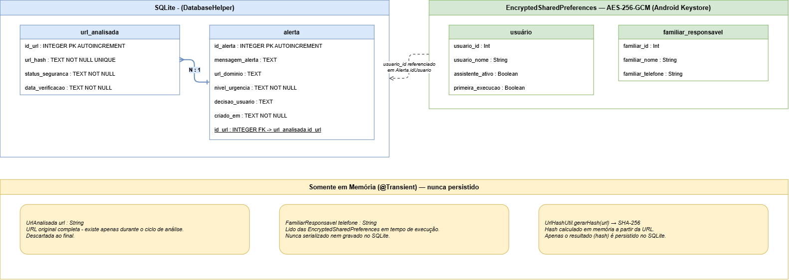

# Assistente de Navegação Segura para Idosos

## Visão Geral

Aplicativo Android que monitora links em segundo plano e exibe alertas visuais acessíveis quando detecta ameaças, antes que o usuário acesse o site. Desenvolvido para o público idoso, com foco em linguagem simples, botões grandes e integração com familiar de confiança.

A proteção é silenciosa para links seguros - o usuário só é interrompido quando há perigo real.

## Como Executar

```bash
# Clonar e abrir no Android Studio
git clone <url-do-repositorio>
```

### Visualizar as telas com Compose Preview
1. Abra o projeto na IDE Android Studio
2. Aguarde a sincronização dos arquivos do Gradle
3. Navegue até os arquivos das telas (especificado na seção de estrutura de arquivos desse README)
4. Abra o arquivo com final "Screen"
5. No canto superior direito do painel de código do Android Studio, mude o modo de exibição de Editor para Editor e Preview ou Preview

## Interface do Usuário

| Tecnologia | Função                                                     |
|---|------------------------------------------------------------|
| **Kotlin** | Linguagem principal - substitui Java em todo o projeto     |
| **Jetpack Compose** | Framework declarativo de UI do Android (sem XML de layout) |
| **Material Design 3** | Sistema de design - componentes, tipografia e cores        |
| **ComponentActivity** | Base das Activities com suporte nativo ao Compose          |

- A UI é descrita por funções Kotlin anotadas com `@Composable`
- O estado da tela é gerenciado com `remember { mutableStateOf(...) }` - quando o estado muda, o Compose redesenha apenas os componentes afetados
- As Activities ficam menores: só configuram o tema e chamam `setContent { }` com o composable raiz

### Estrutura de arquivos

```
ui/
├── MainScreen.kt              # Tela principal
├── AlertaScreen.kt            # Tela de alerta
├── FamiliarCadastroScreen.kt  # Cadastro do familiar
└── theme/
    ├── Theme.kt                 # Cores e MaterialTheme
    └── Type.kt                  # Tipografia (tamanhos em sp)
```

## Banco de dados

O aplicativo guarda o mínimo possível de informação. Os dados ficam em dois lugares diferentes:

| Onde | O que armazena                                  |
|---|-------------------------------------------------|
| Banco de dados local (SQLite) | Histórico de links analisados e alertas gerados |
| Armazenamento seguro (criptografado) | Nome do usuário e contato do familiar           |

---

### SQLite

O banco de dados tem duas tabelas.

#### Tabela `url_analisada`

Guarda os links que o assistente já analisou. Funciona como um "caderno de notas" para evitar verificar o mesmo link duas vezes.

| Campo | Descrição |
|---|---|
| `id_url` | Número de identificação do registro |
| `url_hash` | "Impressão digital" do link (hash SHA-256) — não é o link em si |
| `status_seguranca` | Resultado da análise: SEGURO, SUSPEITO ou PERIGOSO |
| `data_verificacao` | Quando o link foi verificado |

> O link completo **nunca é salvo**. Só uma impressão digital matemática dele, que não permite reconstruir o endereço original.

O resultado fica guardado por **24 horas**. Se o mesmo link aparecer de novo nesse período, o app usa o resultado já salvo sem precisar verificar de novo. Depois de **30 dias**, o registro é apagado automaticamente.

---

#### Tabela `alerta`

Guarda os alertas que foram mostrados ao usuário quando um link suspeito ou perigoso foi detectado.

| Campo | Descrição                                                       |
|---|-----------------------------------------------------------------|
| `id_alerta` | Número de identificação do alerta                               |
| `mensagem_alerta` | Texto do aviso mostrado ao usuário                              |
| `url_dominio` | Só o nome do site (ex: `site-falso.com`) — sem detalhes do link |
| `nivel_urgencia` | ALTA (perigoso) ou MEDIA (suspeito)                             |
| `decisao_usuario` | O que o usuário escolheu fazer                                  |
| `criado_em` | Quando o alerta foi gerado                                      |
| `id_url` | Qual link originou esse alerta                                  |

A decisão do usuário pode ser:
- `AGUARDANDO` — ainda não decidiu
- `SAIU_COM_SEGURANCA` — saiu do link perigoso
- `ENTROU_MESMO_ASSIM` — continuou mesmo com o aviso
- `ACIONOU_FAMILIAR` — pediu ajuda ao familiar cadastrado

---

### O armazenamento seguro (EncryptedSharedPreferences)

Nome do usuário, nome e telefone do familiar ficam em um armazenamento separado, **criptografado**. Esses dados nunca entram no banco de dados.

A criptografia usa o padrão AES-256, com a chave protegida pelo Android Keystore — o cofre de segurança do próprio sistema Android.

---

### O que fica só na memória (nunca salvo)

Duas informações existem apenas enquanto o app está sendo usado e são descartadas logo depois:

- **O link completo** — usado para análise e depois apagado da memória
- **O telefone do familiar** — lido do armazenamento seguro só na hora de acionar, nunca copiado para o banco

---

### Diagrama



A seta entre as duas tabelas mostra que um alerta sempre pertence a um link analisado (um link pode gerar vários alertas, mas cada alerta pertence a um único link).